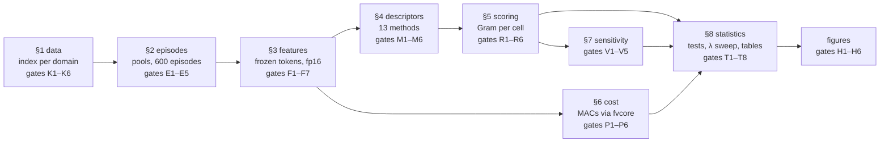

# Second-order descriptors for training-free cross-domain few-shot learning

<!-- TODO: replace OWNER/REPO once the repository exists -->

Code, raw result tables and figures for the manuscript
**"Second-order descriptors for training-free cross-domain few-shot learning"** (under review).

The study asks a narrow question: when a frozen vision foundation model is used without any
training, does a **second-order descriptor** of its patch tokens (covariance, bilinear pooling,
Brownian distance covariance) classify few-shot episodes from distant domains better than the
plain **mean token**, and is the gain driven by the choice of **statistic** or by the
**normalization** applied to it? Everything is training-free: features are extracted once,
prototypes are averages of support descriptors, and queries are assigned to the nearest
prototype under the Frobenius distance.

<p align="center">
  
</p>

*Boundary map. (A-i) Which axis dominates in each condition after Benjamini–Hochberg correction,
(A-ii) magnitude of the two axis effects, (B) the resolution reversal of DINOv3-L/16 on pallet and
texture, (C) the two contrasts per configuration at 5-shot.*

---

## Contents

* [Key findings](#key-findings)
* [Design](#design)
* [Repository structure](#repository-structure)
* [Reproducing the results](#reproducing-the-results)
* [Result tables](#result-tables)
* [Datasets and licences](#datasets-and-licences)
* [Citation](#citation)

---

## Key findings

All numbers below are read from the CSV files in [`results/`](results).

1. **Second-order descriptors beat the mean baseline in most settings, not all.** In closed-set
   accuracy the best of the twelve second-order descriptors exceeds the mean baseline in 102 of
   114 cells (38 of 38 at 1-shot, 32 of 38 at 5 and 10 shots). All twelve exceptions are on
   texture (DTD) at 5 and 10 shots.
2. **Which design axis matters depends on the backbone.** Over the 132 accuracy conditions of
   the core DINO grid, the statistic axis wins in 64, normalization in 39, and 29 are
   inconclusive (q < 0.05). The two objective probes lean the other way: normalization wins in
   35 of 60 conditions (CLIP-B/16 16 against 7, ViT-B/16 19 against 5).
3. **Token count relative to dimension shifts the verdict.** For DINOv3-L/16 on pallet and
   texture, the statistic axis wins in 2 of 12 conditions at 224 pixels (5 normalization, 5
   inconclusive) and in all 12 at 448 pixels, with the same weights (n/d from 0.19 to 0.77).
   Both resolution reversal tests are significant after Holm correction.
4. **Domain-level directions** (confirmatory family of 8 Holm-corrected tests): statistic axis
   on texture, dermoscopy and pallet, normalization axis on satellite imagery, no significant
   direction on crop disease and chest radiography.
5. **The cost axis is the backbone.** Counted in multiply–accumulate operations (MACs), the
   descriptor accounts for at most 5.5% of the cost of a query, so the compute-matched Pareto frontier
   is set by the choice of backbone and resolution. In wall-clock time on a T4, the
   eigendecomposition needed by the spectral normalization levels costs one to three backbone
   passes.
6. **The shrinkage hyperparameter can be dropped.** Over 216 sweep conditions, λ = 0 (no
   shrinkage) is the in-sample best in 138, and the fixed λ = 0.1 is within 0.1 percentage
   points of the best in 160. Selected out of sample on half of the episodes, the median cost
   of fixing λ = 0.1 is 0.03 percentage points (mean 0.15).

The confirmatory family is a confirmatory analysis of design-specified hypotheses: its unit,
domains and the purpose of the 448-pixel cell were fixed by the design, but the family itself
was declared after the exploratory grid had been inspected.

---

## Design

### Factorial grid of descriptors

Thirteen methods: three second-order statistics crossed with a nested ladder of four
normalization levels, plus a first-order baseline. With $G = X^\top X$ and $\mu$ the column mean
of the token matrix $X \in \mathbb{R}^{n \times d}$:

| Statistic | Definition |
|---|---|
| bilinear | $G / n$ |
| covariance | $G / n - \mu\mu^\top$ |
| BDC | double-centred matrix of $\sqrt{G_{kk} + G_{ll} - 2G_{kl}}$ |

| Level | Operation added to the level below |
|---|---|
| raw | none |
| scale | Frobenius normalization |
| power | signed spectral power $\mathrm{sign}(\sigma)\lvert\sigma\rvert^{1/2}$ |
| shrink | Ledoit–Wolf shrinkage towards $(\mathrm{tr}\,S/d)\,I$ with λ = 0.1 |

The baseline is the ℓ2-normalized mean token. All descriptors of a pool are packed
(upper triangle, √2 off the diagonal) so that one Gram matrix per feature cell and method scores
every episode.

### Backbones and feature cells

| Backbone | Hugging Face id | Resolutions | n/d | GMAC per query (5-shot) |
|---|---|---|---|---|
| DINOv2-B/14 | `facebook/dinov2-base` | 224 | 0.33 | 31 |
| DINOv3-B/16 | `facebook/dinov3-vitb16-pretrain-lvd1689m` | 224, 256 | 0.26, 0.33 | 24, 31 |
| DINOv3-L/16 | `facebook/dinov3-vitl16-pretrain-lvd1689m` | 224, 448* | 0.19, 0.77 | 84, 360 |
| CLIP-B/16 (probe) | `openai/clip-vit-base-patch16` | 224 | 0.26 | 23 |
| ViT-B/16 IN-21k (probe) | `google/vit-base-patch16-224-in21k` | 224 | 0.26 | 23 |

\* 448 pixels on pallet and texture only. Seven configurations over six domains give 38 feature
cells. The DINO configurations form the core grid. CLIP and ViT are objective probes at matched
architecture and token count.

### Protocol

* 5-way, 1, 5 and 10 shots, 15 queries per class, **600 episodes** per condition.
* Open-set episodes add 5 unknown classes (AUROC of the nearest-prototype distance) on the four
  domains with at least 10 classes.
* At most 200 images per class enter a fixed pool drawn with the seed. Support and query are
  split at random.
* **Group-aware sampling**: images of the same patient (ChestX) or lesion (ISIC) never appear
  twice in one episode.
* Every random draw derives from one seed through hashed sub-keys, so pools and episodes are
  identical on any machine.

### Statistics

* Paired sign-flip permutation tests (exact for small n) between methods on the same episodes.
* Two-way decomposition of the 3 × 4 grid into a normalization and a statistic mean square. The
  test statistic is $\mathrm{MS}_\mathrm{norm} - \mathrm{MS}_\mathrm{stat}$, because the
  difference of sums of squares is biased towards the axis with more levels under the null.
* Episode bootstrap (50,000 replicates) with weights shared across all backbones scored on the
  same episode file, Benjamini–Hochberg over the grid, Holm within the confirmatory family.

---

## Repository structure

```
.
├── sopfsl.ipynb      full pipeline, with the outputs of the recorded run
├── results/          the raw tables behind every number of the manuscript
├── figures/          Fig1–Fig4 as PNG
├── LICENSE
└── README.md
```

The notebook is organised as nine definition sections and one driver section:



Sections §0 to §8 only define functions and run in seconds. Section §9 runs the pipeline, and
each of its steps ends with `READY FOR STEP N` or `FAIL`. Every artefact carries a hash of its
inputs (`index_hash → pool_hash → feature_key → result_key`), so stale artefacts are rebuilt and
interrupted runs resume. Each code cell is preceded by a markdown cell describing what it does.

---

## Reproducing the results

### Requirements

* Google Colab with a **GPU runtime** (the recorded run used a Tesla T4, high-RAM) and
  **at least 100 GB of free disk**.
* A Kaggle API token saved as `secrets/kaggle.json` in the working directory.
* A Hugging Face read token in the Colab secret `HF_TOKEN`, with the licences of the two DINOv3
  checkpoints accepted on their model pages.
* Python packages are installed by the notebook. The only version bound is
  `transformers >= 4.56` (DINOv3 support).

### Steps

1. Open `sopfsl.ipynb` in Colab and set the two secrets.
2. `Runtime → Restart and run all`.
3. Stop at the first `FAIL` line. The message under it says what to fix.

### Run time and disk

| Step | Wall clock on a T4 | Source |
|---|---|---|
| §9.1 download and index | about 23 min | recorded |
| §9.5 feature extraction, 38 cells (49.2 GB) | about 21 min | recorded |
| §9.8 scoring grid | about 3.3 h | recorded |
| §9.10 sensitivity runs | about 30 min | recorded |
| §9.11 statistical tests | about 10 min | recorded |
| §9.12 λ sweep | about 2 to 4 h | estimate |

The total of 7 to 9 hours exceeds a single Colab session. Everything under `/content/sopfsl` is
lost when the runtime is recycled, so back up `index/`, `episodes/` and `results/` to Google
Drive between sessions:

```bash
tar -C /content/sopfsl -czf /content/drive/MyDrive/sopfsl_light.tar.gz index episodes results
tar -xzf /content/drive/MyDrive/sopfsl_light.tar.gz -C /content/sopfsl
```

> [!WARNING]
> Do not change `CONFIG`, the `*_FORMAT` constants, the extraction batch size (16) or the GPU
> type between sessions. If `results/` is restored but the features are re-extracted on another
> GPU, torch version or batch size, the bit-exact anchors of the λ sweep fail. On a GPU other
> than the T4, fp16 features differ in the last bits and accuracies can differ from the tables
> in the last decimals. The conclusions rest on paired tests within one run.

---

## Result tables

All accuracies and AUROCs are fractions in [0, 1] unless a column name ends in `_pp`
(percentage points). `regime` is `closed` or `open`, `res` the input resolution in pixels.

| File | Rows | Content |
|---|---|---|
| `raw_results.csv` | 3,510 | Every condition × method × metric: `mean`, `se`, 95% interval `ci_lo`/`ci_hi` (mean ± 1.96 SE), `n_episodes`. |
| `raw_axis.csv` | 270 | Axis decomposition per condition: `ss_*` and `ms_*` of each axis and the interaction, `ss_diff` and `ms_diff` with bootstrap interval and p, `q_bh`, `bh_family` (core `axis_C1` or probe `axis_C1_objective`), `verdict`. |
| `raw_confirm.csv` | 20 | The 8 confirmatory tests (`direction|<domain>`, `flip|<domain>`) with `delta`, interval, `p`, `p_holm`, and the 12 per-condition pairs of the two reversal tests (`|pair` rows). |
| `raw_second_vs_mean.csv` | 3,240 | Each second-order method against the mean baseline: `delta`, `se`, paired permutation `p`, `p_holm` (Holm over 12 methods). |
| `raw_sensitivity.csv` | 1,092 | Index-ordered split (`by_index`, paired) and image-level sampling (`no_groups`, unpaired) against the canonical protocol: `delta`, `se`, `p`, `p_holm` (Holm over 13 methods). |
| `raw_lambda.csv` | 1,728 | Closed-set accuracy for each λ in {0, 0.02, 0.05, 0.1, 0.2, 0.4, 0.7, 1} on the four sweep backbones. λ = 1 is a degenerate anchor, not a candidate value. |
| `raw_lambda_split.csv` | 216 | Out-of-sample analysis over 20 random halvings: `delta_oos_median` and `delta_oos_worst` (percentage points, λ = 0.1 minus the λ selected on the other half), share of splits selecting 0.1, share significantly worse. |
| `raw_shrink_vs_power.csv` | 576 | Shrink minus power level per statistic and condition (`delta_pp`, λ = 0.1 against λ = 0 on the same episodes), paired permutation `p`, `p_holm3` (Holm over the three statistics). |

`raw_lambda_split.csv` and `raw_shrink_vs_power.csv` are produced by §9.13b and §9.11b of the
notebook. Their `p` columns come from Monte Carlo permutation tests seeded from the test key,
so a rerun reproduces them exactly only with the same key strings.

---

## Datasets and licences

| Domain | Source | Licence |
|---|---|---|
| Pallet | [`jjldo21/IndustrialLateralLoads`](https://huggingface.co/datasets/jjldo21/IndustrialLateralLoads) (DOI 10.57967/hf/4799) | MIT |
| Crop disease | [`saroz014/plant-disease`](https://www.kaggle.com/datasets/saroz014/plant-disease) (PlantVillage) | see dataset page |
| Satellite (EuroSAT) | `torchvision.datasets.EuroSAT` | MIT |
| Texture (DTD) | `torchvision.datasets.DTD` | research use only |
| Dermoscopy (ISIC 2018 Task 3) | [ISIC challenge data](https://challenge.isic-archive.com/data/#2018) | CC BY-NC |
| Chest radiography (ChestX-ray14) | [`nih-chest-xrays/sample`](https://www.kaggle.com/datasets/nih-chest-xrays/sample), official 5% sample | NIH |

The datasets are not redistributed here. The notebook downloads them from their original
sources. No ISIC image appears in any figure, in line with its non-commercial licence.

---

## Citation

The manuscript is under review. Until it is published, please cite:

```bibtex
@unpublished{nguyen2026secondorder,
  title  = {Second-order descriptors for training-free cross-domain few-shot learning},
  author = {Nguyen, Phuoc Dai and Huynh, De-Thu and Nguyen, Huy T.},
  note   = {Manuscript under review},
  year   = {2026}
}
```

## License

Code: see [`LICENSE`](LICENSE). Result tables and figures are released with the code. The
datasets keep their own licences listed above.